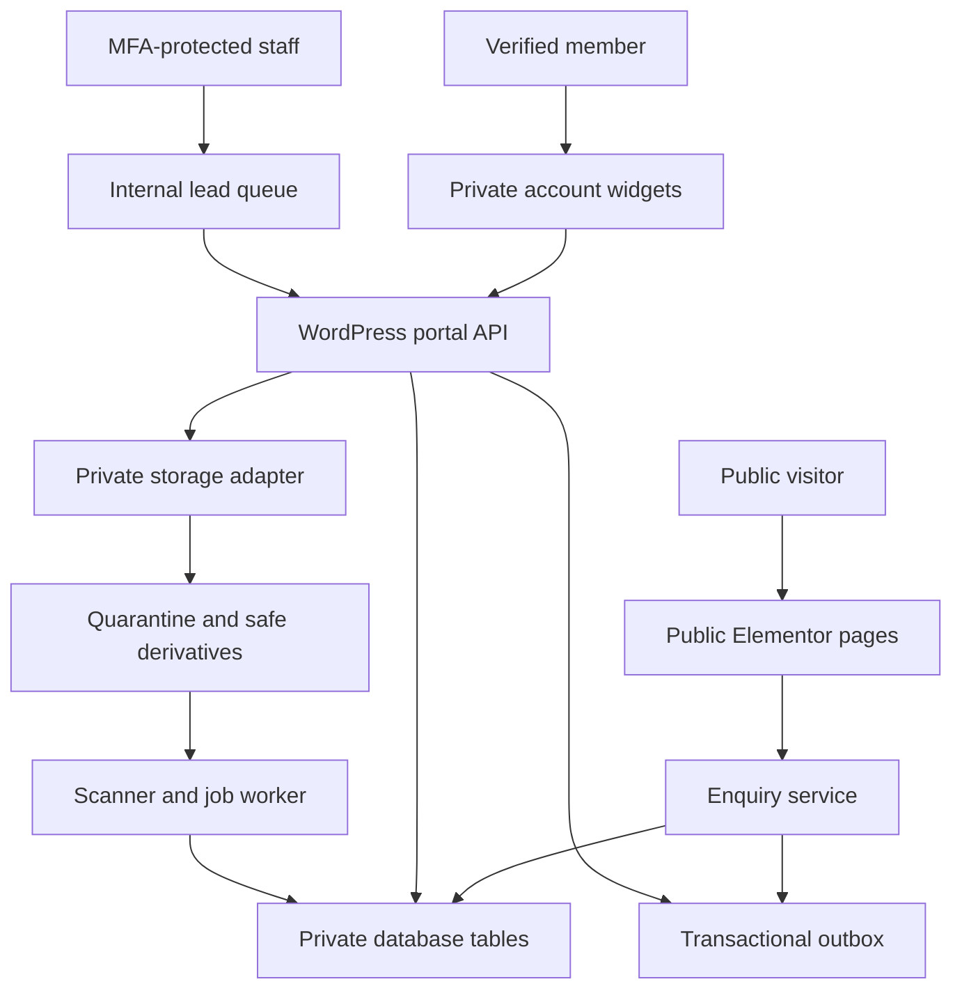
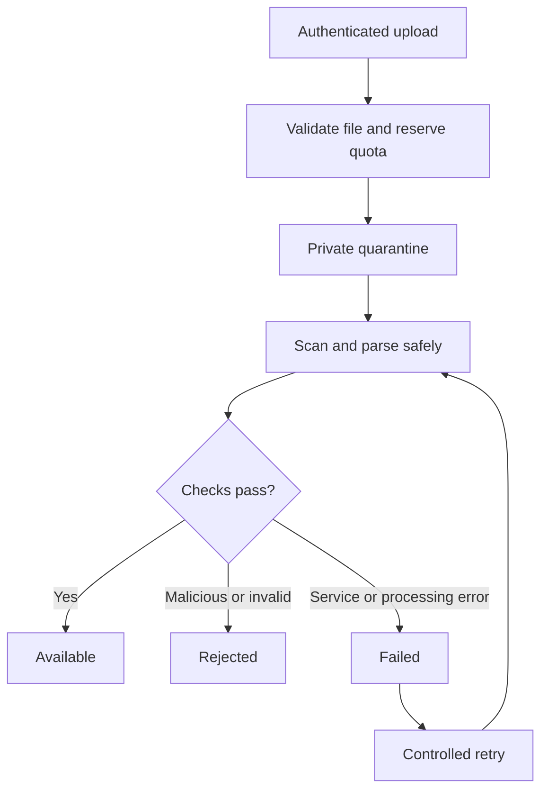

# Technical Requirements Document — It's All About Insurance

**Brand:** It's All About Insurance — Anand Ahirwar  
**Document:** TRD / Technical Requirements Document  
**Version:** 1.0  
**Date:** 8 October 2026 — Asia/Kolkata  
**Source:** “Its_All_About_Insurance_Website_PRD (1).md”, PRD version 2.0  
**Platform:** WordPress + Elementor  
**Default language:** English; explicit Hindi switch  
**Status:** Technical specification for implementation. No website, repository, host integration or production deployment has been created by preparing this document.

## 1. उद्देश्य और requirement authority

यह TRD, PRD को developer के लिए implementable architecture, data contracts, API rules, infrastructure requirements, deployment workflow और test evidence में बदलता है। Public website, account portal और staff queue एक ही WordPress installation का हिस्सा होंगे। WordPress identity और authentication का authoritative source रहेगा।

Requirement labels:

| Label | Meaning |
|---|---|
| MUST | PRD requirement या उसे पूरा करने के लिए आवश्यक technical control |
| PROPOSED DEFAULT | इस TRD का engineering default; infrastructure/owner review के बाद configuration में finalize होगा |
| TO CONFIRM | Business facts, hosting access, license या operating policy अभी उपलब्ध नहीं |
| OUT OF SCOPE | इस release में implement नहीं होगा |

PRD version 2.0 product scope की authority है। Proposed defaults PRD में बताए गए limits या permissions को चुपचाप बदल नहीं सकते। Infrastructure-dependent items को implemented/production-ready तभी कहा जाएगा जब corresponding acceptance evidence मौजूद हो।

## 2. Launch scope और boundaries

### 2.1 P0 implementation

- English/Hindi public pages: Home, About, Health, Term, Policy Review, Claim Help, Learn, Stories, Contact और legal/disclosure pages.
- Guest और member enquiries; durable backend; consent; idempotency; assigned internal lead queue.
- User Login modal/drawer और /account/ fallback; Create Account, email verification, Forgot/Reset Password.
- My Dashboard, My Profile, My Reports, Treatment History, My Enquiries और Account Settings.
- Private PDF/JPG/PNG upload, quarantine/scan, metadata filters/search, preview/download और deletion.
- Selected report/profile-section sharing with named staff for an assigned enquiry; expiry और revocation.
- Individual Elementor-editable pages, dynamic widgets, header/footer और safe synthetic editor previews.
- Canonical modular plugin source; plugin ZIP, Code Snippets JSON/PHP exports और runtime guards.
- New private GitHub repository, develop→staging और main→production automatic deployment; conflict-aware templates, migrations और rollback.
- Security, accessibility, privacy, backup restore और AC01–AC30 verification.

### 2.2 Deferred/excluded

Dependent/family profiles, booking, calculators, CRM, authorized live quotes और Instagram automation बाद की scope हैं। Public upload, payment/checkout, instant policy issuance, universal insurer ranking, AI diagnosis/report interpretation, prescriptions, health scores और insurance eligibility automation शामिल नहीं हैं। Investment के लिए verified scope मिलने तक केवल approved education हो सकती है।

## 3. Architecture

### 3.1 System topology

WordPress users/core sessions identity संभालेंगे। Custom plugin server पर validation, authorization, storage, notifications और audit करेगा। Elementor presentation layer है; widget visibility किसी record का access permission नहीं है।

### 3.2 Runtime separation

| Area | Runtime | Data boundary |
|---|---|---|
| Public site | WordPress Pages + native Elementor widgets | Approved editorial content only |
| Auth/account portal | Registered Elementor widgets + WordPress APIs | Current verified user's records |
| Staff queue | Capability-protected wp-admin screens | Assigned leads; consented selected records |
| File service | Permission-checked PHP stream/response service | Private binaries; no public media attachment |
| Worker | Host scheduler + bounded PHP worker | Scan/mail/purge/export jobs |
| Deployment | GitHub Actions + authorized host release adapter | Managed code/templates; no user-data synchronization |

Frontend assets use minimal JavaScript modules and CSS. A separate React/Next.js application or independent authentication backend is not part of this design.

## 4. Technology baseline और dependencies

| Component | Decision | Configuration/validation |
|---|---|---|
| WordPress | Supported stable release | Exact version pinned after staging compatibility tests |
| PHP | 8.3+ within supported host/plugin matrix | Extensions: fileinfo, sodium/OpenSSL as applicable, mbstring, DB driver, image support |
| Database | MySQL 8.0+ or MariaDB 10.11+; InnoDB; utf8mb4 | Transactions, UTC storage, backup restore test |
| Theme | Hello Elementor or tested compatible lightweight theme | Child theme only for necessary versioned overrides |
| Elementor | Supported stable release | Exact version locked; custom widgets must pass editor tests |
| Elementor Pro | TO CONFIRM license | Needed if selected header/footer, Theme Builder or kit features depend on Pro |
| Custom plugin | IAAI Portal | Namespaced PHP modules; source-controlled assets |
| Code Snippets | Compatible selected version | Genuine export-format fixture used to generate import files |
| Multilingual | One tested WordPress multilingual integration | Adapter must support root English, /hi/, Elementor pages and shared portal routes |
| Transactional mail | One authorized provider/integration | Real delivery tests, retry and bounce/error visibility |
| MFA | One tested privileged-login solution | Must protect custom auth and core/admin entry points |
| Malware/PDF processing | Host worker or approved private scanning service | Privacy terms, timeouts, signature freshness and fail-closed behavior verified |
| Tests | PHPUnit/WordPress integration + browser E2E | Synthetic accounts/reports only |
| CI/build | Composer/toolchain and reproducible build scripts | Lockfiles; versioned artifacts; no proprietary vendor binaries without rights |

WordPress's official hosting recommendations inform the PHP/database baseline [R01]. Exact plugin versions, license entitlements, host resources and provider selection are not inferred from this PRD.

### 4.1 Hosting readiness

The host MUST provide HTTPS, isolated staging, private storage, worker scheduling, encrypted storage/backups, secret configuration, cache bypass and a tested secure deployment route. GitHub Pages cannot serve this WordPress/PHP backend.

PROPOSED DEFAULT application allocation: PHP memory at least 256 MB, with additional isolated worker capacity based on scanner/PDF load. Request limits must accommodate five 10 MB files plus multipart overhead; proposed host post limit is 64 MB or greater. These are application sizing proposals, not universal WordPress minimums.

If the host cannot meet secure upload, scanning or private storage requirements, real-report upload remains disabled. A synthetic staging UI may still be developed.

## 5. Repository और module structure

Proposed new private repository name: **its-all-about-insurance-wordpress**. Account/organization ownership and name availability are TO CONFIRM. Preparing this TRD does not authorize creating unrelated repositories.

| Path | Contents |
|---|---|
| wp-content/plugins/iaai-portal/iaai-portal.php | Plugin header, dependency checks, runtime bootstrap |
| wp-content/plugins/iaai-portal/src/Bootstrap/ | Module loader, settings, readiness, migrations |
| wp-content/plugins/iaai-portal/src/Auth/ | Registration, verification, recovery, sessions, MFA adapter |
| wp-content/plugins/iaai-portal/src/Profile/ | Optional profile/background/medical sections |
| wp-content/plugins/iaai-portal/src/Reports/ | Upload, quota, metadata, scan states, private delivery |
| wp-content/plugins/iaai-portal/src/Treatment/ | Own timeline and report relationships |
| wp-content/plugins/iaai-portal/src/Enquiries/ | Guest/member intake, queue, assignment/status |
| wp-content/plugins/iaai-portal/src/Sharing/ | Grants, selected resources, expiry/revocation |
| wp-content/plugins/iaai-portal/src/Privacy/ | Consent, export, deletion, retention, WordPress hooks |
| wp-content/plugins/iaai-portal/src/Audit/ | Safe event schema and privileged audit views |
| wp-content/plugins/iaai-portal/src/Jobs/ | Outbox/worker, leases, retries, dead-letter handling |
| wp-content/plugins/iaai-portal/src/Elementor/ | Custom widget registration and editor controls |
| wp-content/plugins/iaai-portal/src/Infrastructure/ | DB repositories, crypto, storage/mail/scanner adapters |
| wp-content/plugins/iaai-portal/assets/ | Scoped styles, browser controllers, translations |
| wp-content/themes/iaai-child/ | Optional minimal overrides |
| snippets/ | Per-module JSON and PHP export packages |
| elementor/pages/ and elementor/global/ | Individual page/header/footer/template JSON |
| migrations/ | Versioned forward-safe DB/template migration definitions |
| scripts/ | Build, package validation, deploy, health, import, rollback |
| tests/ | Unit, integration, E2E, synthetic fixtures and deployment tests |
| docs/ | Setup, operations, import/export, restore and troubleshooting |
| .github/workflows/ | Check, deploy-staging, deploy-production and rollback |

Namespace: **IAAI\Portal**. REST namespace: **iaai/v1**. Browser events/assets/classes use an **iaai-** prefix. Direct executable PHP files reject direct web access.

MUST exclude credentials, wp-config.php secrets, production SQL, uploads, medical reports, private logs, account exports, encryption keys, paid licenses and vendor packages without redistribution rights. Test fixtures contain synthetic information and are explicitly labelled.

## 6. WordPress identity, roles और authorization

### 6.1 Roles/capabilities

| Role | Suggested role key | Allowed | Explicit restrictions |
|---|---|---|---|
| Member | iaai_portal_user | Own profile/reports/timeline/enquiries/settings; create/revoke own grants | No staff queue, content editing or routine wp-admin |
| Service agent | iaai_service_agent | Assigned lead details/status/follow-up; specifically granted record reads | No unassigned lead detail, bulk export, owner record mutation |
| Content editor | iaai_content_editor | Draft/edit approved page/article presentation | No enquiries, profiles, report bytes, grants or private audit detail |
| Reviewer | iaai_reviewer | Review assigned educational/case content | No lead/medical permissions by default |
| Owner/operations manager | iaai_manager | Staff assignment, safe settings, queue oversight, audit review, permitted lead export | No routine medical browsing |
| Technical maintainer | WordPress administrator with controlled access | Install/update trusted code and infrastructure | Elevated operational role, MFA and audit; separate from everyday owner account |

Custom capability examples: iaai_manage_own_records, iaai_view_assigned_enquiries, iaai_update_assigned_enquiries, iaai_assign_enquiries, iaai_manage_settings, iaai_export_leads, iaai_review_audit, iaai_request_support_access.

Use capability + object-level policy checks. Role names and a logged-in test alone never authorize access. Ordinary WordPress content capabilities must not imply private-record access.

A full WordPress administrator/host operator can technically alter code or access infrastructure. UI/API restrictions govern application behavior; this design does not claim to cryptographically isolate records from an unrestricted server administrator. Separate technical-maintenance access, minimize its use and record privileged operations.

### 6.2 Central policy service

All controllers and workers call one policy layer. A report read is allowed only when:

1. The requester has an active verified account and an allowed bounded session.
2. The record exists, is not deleted and has Available scan state.
3. The requester is its immutable owner; OR an active grant explicitly includes that report, recipient and enquiry.
4. For staff: MFA is satisfied, staff is still assigned to that enquiry, grant is unexpired/unrevoked, and enquiry permits continued access.
5. No account/consent restriction or exceptional-access expiry blocks the action.

Staff grants permit read/preview/download only. They do not permit deleting, altering or re-sharing user files. Owner IDs are assigned from server authentication and never accepted from browser input.

All profile, timeline, grant, privacy-export and enquiry endpoints have equivalent explicit object policies. Cross-owner timeline/report references are rejected.

### 6.3 Exceptional support access

Routine admin medical browsing is unavailable. A controlled support-access flow requires a named issue, affected owner, selected records, reason, privileged MFA/reauthentication and an audited expiry. PROPOSED DEFAULT expiry: 15 minutes. Support access is displayed in the owner's access history and does not enable bulk record export. Final operating procedure is TO CONFIRM.

## 7. Data model और schema

### 7.1 Common conventions

- WordPress table prefix is dynamic; **{prefix}iaai_** below is a placeholder.
- Primary keys: BIGINT UNSIGNED internal ID. Exposed record references: randomly generated UUID/public IDs; unpredictability supplements authorization.
- Owner/staff identity references WordPress users. Deletion/export hooks handle core-user lifecycle.
- Timestamps are UTC; interface dates use selected locale and configured timezone.
- Report/test dates are DATE values, not timezone-shifted timestamps.
- Version fields support optimistic concurrency; stale updates return conflict.
- Text lengths, enums and JSON fields have server allowlists; all SQL uses prepared queries.
- Sensitive payloads use authenticated encryption with key identifiers; keys remain in host secret configuration.
- Custom tables use InnoDB. Referential integrity is enforced by service transactions and tested consistency checks; do not assume WordPress/dbDelta creates cross-table foreign keys.
- No private table is exposed as a public custom post, Media Library attachment or generic REST collection.

### 7.2 Table inventory

| Table | Main fields | Constraints/indexes |
|---|---|---|
| iaai_accounts | user_id, verified_at, state, locale, consent_version, security_epoch, created_at | Unique user_id; state enum active/pending/restricted/deletion_pending |
| iaai_profiles | user_id, contact_cipher, background_cipher, medical_cipher, key_id, version, updated_at | Unique user_id; optional sections, no inferred values |
| iaai_reports | id, public_id, owner_id, storage_key, original_meta_cipher, display_meta_cipher, key_id, category, report_date, mime, size_bytes, state, checksum, version, deleted_at, created_at | Unique public_id/storage_key; owner+date/category/state; private checksum |
| iaai_upload_batches | id, public_id, owner_id, request_hash, state, reserved_bytes, expiry, created_at | Unique owner+idempotency hash; bounded batch lifecycle |
| iaai_storage_usage | user_id, used_bytes, reserved_bytes, updated_at | Unique user_id; transactional quota reservation |
| iaai_treatments | id, public_id, owner_id, event_date, type, detail_cipher, key_id, version, deleted_at | owner+date; bounded type enum |
| iaai_treatment_reports | treatment_id, report_id, owner_id | Unique treatment+report; both records must share owner |
| iaai_enquiries | id, public_ref, user_id nullable, service, contact_cipher, request_cipher, key_id, locale, source_code, urgency, status, assignee_id nullable, followup_at, close_reason, version, created_at | Unique public_ref; assignee+status+followup, service+created, user_id |
| iaai_enquiry_events | id, enquiry_id, actor_id, event_type, note_cipher optional, key_id, created_at | enquiry+created; private chronological notes |
| iaai_grants | id, public_id, owner_id, enquiry_id, recipient_id, purpose_code, expires_at, revoked_at, created_at | owner/enquiry/recipient+expiry; single identified recipient per grant |
| iaai_grant_reports | grant_id, report_id | Unique grant+report; owner match |
| iaai_grant_profile_sections | grant_id, section_key, snapshot_cipher, key_id, source_version | Explicit section snapshot; no entire-profile wildcard |
| iaai_consents | id, user_id nullable, enquiry_id nullable, purpose, text_version, decision, created_at, withdrawn_at | Separate enquiry/storage/marketing purposes; append history |
| iaai_auth_tokens | id, user_id, purpose, token_hash, expires_at, consumed_at, created_at | Unique token_hash; verification/email-change/contact-link tokens only |
| iaai_idempotency | scope, actor_hash, key_hash, payload_hmac, result_ref, state, expires_at | Unique scope+actor+key; no plaintext form payload |
| iaai_support_access | id, public_id, actor_id, owner_id, issue_ref, reason_code, expires_at, revoked_at, created_at | Actor/owner/expiry; exceptional MFA-protected scope only |
| iaai_support_access_resources | support_access_id, resource_type, resource_id | Unique support-access+resource; specific records only |
| iaai_audit | id, actor_id nullable, actor_type, action, target_type, target_ref, result, reason_code, created_at | target+created; safe identifiers; restricted access |
| iaai_jobs | id, type, resource_ref, payload_cipher optional, key_id, state, attempts, run_at, lease_until, last_error_code, created_at | state+run_at; stable deduplication key |
| iaai_privacy_requests | id, public_id, owner_id, type, status, export_storage_key nullable, expires_at, created_at | owner+created; export itself private |
| iaai_managed_templates | deployment_key, locale, post_id, last_base_hash, incoming_version, last_release, state | Unique deployment_key+locale |
| iaai_migrations | migration_id, checksum, applied_at, release_id | Unique migration_id; checksum drift blocks execution |
| iaai_rate_limits | bucket_hash, window_start, count, expires_at | Atomic counters, TTL cleanup; no raw IP/email |

Queue jobs include transactional-mail outbox items. A separate mail table is unnecessary unless provider integration needs delivery-state details; provider message ID and safe accepted/delivered/bounced states can live in bounded encrypted job metadata. No mail job contains reports or medical narratives.

### 7.3 Field definitions

**Profile:** WordPress remains authoritative for username/email/password. Optional phone/city, year of birth/age, occupation and reason for using portal are user supplied. Medical sections contain optional self-reported conditions, allergies, medication, surgery/hospitalization/history and last-updated dates. Every medical field is skippable/removable. Government IDs and detailed income are not required.

**Reports:** Category enum: blood_lab, imaging, prescription, consultation, treatment, discharge, insurance_claim, other. Lab subtype is an organizational enum only. Display metadata contains title, provider and personal note. Notes are excluded from staff display unless that sharing scope expressly includes them.

**Enquiry:** service enum health, term, policy_review, claim_help. Required name, validated contact number and enquiry-contact consent. Optional email, city, language, callback window and bounded service-specific fields. Contact is normalized to an approved phone format; India launch default is +91 mobile validation, with broader geography TO CONFIRM. No full policy/government identifiers are requested.

**Treatment:** consultation, test, medication_record, procedure, hospitalization. User wording is stored without interpretation. Delete/edit operations validate every linked report belongs to the same user.

### 7.4 Sensitive search

Encrypt report title/provider/notes, medical profile and treatment details. P0 search uses authorized owner-scoped candidate rows, decrypts on the server within a bounded process, then matches permitted fields. Category/date/state use indexed non-narrative columns. Search text stays out of URLs, access logs, analytics and plaintext shared search indexes.

Use POST /reports/search for private search input. Pagination cursors bind to requester and search criteria; search state is encrypted and short-lived if persisted. Staff search is restricted to granted records and excludes unshared notes. Benchmark with synthetic libraries before approving scale; do not claim encrypted fields support ordinary database LIKE queries.

## 8. Authentication और account lifecycle

WordPress APIs own password hashing and sessions. Registration uses wp_insert_user/wp_create_user; login uses the tested WordPress authentication path. Core reset-key validation and reset functions remain authoritative [R02–R05]. There is no parallel password table, JWT store or custom emailed password.

### 8.1 Shared interface

The User Login button opens the same reusable auth component used on /account/. States: Log In, Create Account, Verification Pending, Forgot Password, Reset Password, invalid/expired link and success. Desktop modal traps focus; Escape/close returns focus; mobile drawer/full-page fallback works. Passwords are never stored in localStorage, query strings, templates or analytics.

Successful login redirects to /my-dashboard/ or a server-validated same-origin portal destination. Do not accept external redirect URLs.

### 8.2 Public auth endpoints and CSRF

Login/register/recovery are deliberate public entry points, not private record endpoints. They require same-origin requests, strict Origin validation, anti-abuse controls and a short-lived pre-auth session token bound to a Secure/HttpOnly/SameSite cookie. A generic WordPress guest nonce alone is not the complete anti-CSRF design.

Authenticated REST requests use WordPress cookies and X-WP-Nonce for wp_rest. Missing/expired nonce produces a fresh-auth/retry state; cookies do not replace nonce/permission checks [R02]. Private GET/file requests also carry a valid authenticated REST nonce in the request header. Nonces are never treated as record authorization or one-use recovery tokens.

### 8.3 Registration and verification

1. Validate name/email/password confirmation, account acknowledgement and separate optional marketing consent.
2. Create least-privilege WordPress account; default locale en; create no medical records.
3. Record consent and issue random verification token; store only its hash in iaai_auth_tokens.
4. Durably schedule transactional email; UI reports pending verification, not an invented delivery.
5. User opens link; token validation and consumption are atomic; expired/used tokens fail safely.
6. Mark verified; reports/profile-medical operations become available subject to storage readiness and storage consent.

PROPOSED DEFAULT verification TTL: 24 hours; resend cooldown: 60 seconds. Resend invalidates earlier unused tokens and is rate limited. Email scanners opening a link must not verify or consume it automatically: link opens a confirmation state, and deliberate POST completes verification.

Generic duplicate-account behavior protects enumeration. Password strength guidance supports password managers/paste. Suggested minimum password length and any plugin strength policy are finalized in the tested security matrix.

### 8.4 Password recovery

Forgot Password accepts email/username and returns a generic response. Use retrieve_password or a documented equivalent core-compatible flow, customize the destination to /account/ Reset Password state, validate using check_password_reset_key and finalize using reset_password [R03–R05].

PROPOSED DEFAULT reset TTL: 60 minutes configured through the supported WordPress filter. New requests supersede earlier keys. Reset submission must atomically reject reuse/concurrent consumption; test core integration and add a per-user lock where necessary. Invalidate old sessions after success. The verification table must not replace WordPress password-reset key storage.

Do not put account tokens or login identifiers into analytics. Scrub query/body values from web/PHP error logs; use Referrer-Policy: no-referrer and remove token-bearing query values from browser history after secure intake.

### 8.5 Sessions, reauthentication and MFA

PROPOSED DEFAULT private-record policy: 30-minute idle limit, 8-hour maximum portal session and reauthentication within 10 minutes for email/password change, export and account deletion. Remember Me may retain a basic login but does not bypass the fresh-session requirement for sensitive operations. Enforce timeouts server-side.

Use WordPress session-token management for Logout and Logout Other Sessions. New email remains pending until verified; do not immediately replace the active email. Notify old/new addresses with nonsensitive security notices.

MFA is mandatory for all privileged staff identities. The selected MFA integration MUST challenge both the custom login interface and core wp-login/admin entry paths before issuing privileged access. A direct wp_signon call must not become an MFA bypass. Recovery codes/enrollment procedures are TO CONFIRM and tested. Ordinary users' MFA is P1.

## 9. Enquiry intake और internal queue

### 9.1 Form validation

All service forms call the same backend contract. Field rules include trimmed name, validated phone, valid optional email, service enum, preferred locale, bounded text and approved campaign code. Service-specific fields:

| Service | Allowed additional fields |
|---|---|
| Health | Household size, broad age bands, annual budget band explicitly INR/year, parents option |
| Term | Age band, number of dependants, callback window |
| Policy Review | Product type, optional insurer, main question |
| Claim Help | Claim type, optional insurer, hospitalized yes/no/prefer_not_to_say, short issue summary |

Consent checkboxes default unchecked; marketing is separate and optional. Enquiry copy warns against full policy numbers, IDs and medical-report narratives. Server drops unsupported sensitive/campaign parameters rather than recording arbitrary URL queries.

### 9.2 Durable submission and idempotency

Client generates a random request key per intentional submission and reuses it on retries. Server scopes it to the authenticated user or pre-auth submission session, compares payload HMAC and commits enquiry + consent + notification job in one transaction.

- Same key/same payload: return original safe result.
- Same key/different payload: 409 conflict.
- Separate intentional enquiries: new keys; do not deduplicate people by phone.
- Storage failure: no success/reference; safe retry message.
- Notification failure after commit: enquiry remains saved; retry job independently.
- Returned reference is random and does not authorize public status lookup.

PROPOSED DEFAULT idempotency window: 24 hours. Expired records are purged according to approved operational policy.

### 9.3 Assignment and workflow

Status enum: new → assigned → contact_attempted → connected → guidance_in_progress → closed. Closing requires close reason: guidance_completed, unable_to_reach, duplicate, withdrawn, out_of_scope. Persist events, assignee changes and follow-up dates. Claim outcome is a separate reviewed field; Closed does not mean settled.

Managers can assign/reassign. Agents access only assigned restricted details. Reassignment and enquiry closure immediately invalidate former staff grants according to the confirmed workflow. Bulk export is manager-only, MFA-protected, audited and excludes medical data. Dashboard highlights unassigned backlog and overdue follow-up.

Guest enquiries are not auto-linked by matching phone/email. A specific past enquiry can be claimed only through a one-use verified-contact link whose contact destination came from that stored enquiry. Link only that enquiry; do not reveal other matches. Claim/link requests return generic responses and safe errors.

Success acknowledgement is English by default, for example: “Your enquiry has been received. Reference: [ID]. Our team will contact you during the published working hours.” Hindi uses the translated equivalent from the PRD.

## 10. Private report upload pipeline

### 10.1 Limits and file rules

| Rule | Contract |
|---|---|
| Allowed files | PDF, JPG/JPEG, PNG |
| Per-file limit | 10 MB; UI/server use a documented consistent byte definition |
| Batch limit | Five files per upload |
| Account quota | Proposed PRD quota 250 MB; configurable after hosting confirmation |
| Rejected | Executables, SVG/HTML, archives, mismatched MIME/extension, encrypted/password-protected PDFs, malformed/active-content documents |
| Required consent | Explicit private-storage consent before first upload; current version recorded |
| Privacy | No OCR, diagnosis, report translation, values extraction or health score |

Implementation must settle MB as decimal or binary and display the same interpretation. PROPOSED DEFAULT is decimal: 10,000,000 bytes/file and 250,000,000 bytes/account. Changing this definition requires consistent UI/tests and hosting approval.

### 10.2 Pipeline

Upload transaction protocol:

1. Check verified account, consent, session, count, extension, actual MIME, size, ownership of optional treatment link and infrastructure readiness.
2. Lock usage row; reserve aggregate bytes including concurrent batches. Pending/quarantine files count toward quota.
3. Write to random private quarantine keys, never a user-provided path or Media Library URL.
4. Confirm file persistence; create metadata and scan jobs; commit state. Compensate partial storage/DB failure and release quota.
5. Worker acquires lease, scans for malware, validates PDF/image structure and disallowed active content, and checks corruption/password protection.
6. Generate safe preview derivatives in an isolated resource-limited process. Derivatives remain private and inherit owner/state.
7. Publish Available only after required checks succeed; record checked timestamp and scanner/parser version.
8. Release reserved bytes into used bytes exactly once; rejected/deleted files purge and release accounting according to state.
9. A stale/broken batch is reconciled by job; no orphan file becomes visible.

PROPOSED DEFAULT batch behavior: validation rejects the request if any file fails upfront validation; accepted files thereafter have individual scan outcomes. Upload response identifies each accepted file and Pending Scan state. UI must display partial processing results honestly.

### 10.3 Fail-closed states

Pending Scan: no report bytes available to owner/staff. Rejected: file failed security/content checks; display safe reason category. Failed: infrastructure/processing issue, retry possible; it is not Available. Malware scanner unavailable or signatures outside configured freshness threshold disables new acceptance or keeps files quarantined. There is no “scanner unavailable, approve anyway” path.

The scanner service must have approved handling/privacy terms. Do not send reports to public multi-vendor scanning services without authorization. Scanning alone does not remove PDF scripts/embedded attachments; enforce a separate parser/content policy.

### 10.4 Replacement/versioning

A replacement is a new immutable report record linked to an earlier own report, not an overwrite of original bytes. Old grants do not silently include the replacement. Users must expressly share the new record. Metadata edits use a version number and conflict response.

## 11. Storage, encryption और private file delivery

### 11.1 Storage adapter

Storage interface exposes putQuarantine, readPrivate, createDerivative, delete, stat and readiness. PROPOSED production preference is a private encrypted object store if the chosen host supports it; an outside-web-root local backend is acceptable only with equivalent encrypted storage and tested isolation.

Local path comes from IAAI_PRIVATE_ROOT outside the served document root. Object storage has public access disabled and separate production/staging credentials. Storage keys are random, server-generated and never returned as download URLs.

Encryption at rest covers originals, derivatives, quarantine and backups. Local implementation uses host encrypted volumes or a reviewed streaming envelope-encryption implementation. Metadata encryption uses vetted authenticated-encryption APIs with key IDs; do not implement cryptographic primitives. Separate DB/storage/backup keys where practical; key recovery and rotation are operational requirements.

Scanning may need plaintext temporarily: use private isolated temporary storage, restrictive file permissions, controlled deletion, no public directories or debug copies. Keys never go to browser, GitHub, CI artifacts or mail.

### 11.2 Delivery

GET /reports/{id}/content or a dedicated private binary handler authenticates the current WordPress session, validates nonce/session freshness and calls the record policy immediately before every read. The endpoint serves original bytes as authorized attachment, or safe preview bytes for preview mode.

If REST is used for binary bytes, use a dedicated controlled response path such as rest_pre_serve_request with full headers and no JSON serialization; authorization must already have run. The exact streaming adapter is tested rather than returning binary content as ordinary JSON.

Frontend performs a header-authenticated request and uses a temporary in-memory blob/object URL for safe viewing/download; revoke it on close/logout. No reusable storage URL or URL bearer token is delivered. Do not persist files in browser localStorage/IndexedDB/service-worker caches. An already downloaded copy cannot be recalled.

Required private-response headers include:

| Header | Value/behavior |
|---|---|
| Cache-Control | private, no-store, max-age=0 |
| X-Robots-Tag | noindex, nofollow |
| X-Content-Type-Options | nosniff |
| Referrer-Policy | no-referrer |
| Content-Disposition | attachment for originals; controlled behavior for safe derivatives |
| Content-Type | Server-detected allowed MIME |
| Content-Security-Policy | Restrictive policy compatible with chosen private viewer; no report scripts |

Set equivalent policies on error responses, account HTML and private metadata. Sensitive HTML cannot be shared-cached. File access is audited with safe record identifiers. Revocation stops subsequent fetches immediately; in-progress/already received bytes cannot be undone.

### 11.3 Preview approach

PDF previews use a hardened, locally hosted renderer without active scripts, or server-generated page-image derivatives. PROPOSED DEFAULT is isolated server-rendered page images plus original authorized download. It must support multipage PDFs and bounded CPU/memory/page processing; oversized processing jobs fail safely with a clear state. JPG/PNG display through controlled private delivery after structural checks. Rendering dependencies and resource limits are pinned and vulnerability-reviewed.

### 11.4 Cache isolation

Exclude /account/, all /my-* routes, /account-settings/, portal APIs, auth APIs, stream/export handlers and internal queue from CDN, reverse-proxy, page and widget caches. Exclude logged-in personalized headers from public caches or render only a safe anonymous shell with private session hydration.

Private Elementor widgets are dynamic and must not opt into static output caching [R07]. No advertising pixels, third-party embeds, session replay or service-worker offline caching on portal/confirmation pages. Test two accounts through the actual hosting/cache layer, including private error responses.

## 12. Sharing और revocation

Sharing is owner-initiated and starts with no selected files or recipients. UI identifies enquiry, assigned staff, purpose, selected reports/profile sections and expiry.

Creation checks: owner owns the enquiry and selected resources; enquiry is eligible; recipient is identified/assigned active staff; expiry is bounded; consent/version is recorded. Each grant has one recipient; multiple staff require separate explicit grants. PROPOSED DEFAULT expiry: seven days with a configurable maximum finalized by owner.

Profile sharing uses selected section snapshots and source version, preventing later profile edits from silently revealing additional information. Updated sections require new consent/grant. Report binaries are immutable; unshared personal notes stay private. Treatment timeline sharing is not automatically introduced by a report grant.

Revoke uses an authenticated POST/DELETE, commits revoked_at and increments authorization/security version where used. Expiry/revocation is checked from current authoritative state on every read, without relying on a daily cleanup job. Staff reassignment, role removal, enquiry closure and account restriction also stop grant access. User UI shows active/expired/revoked history and safe access events.

No grant permits testimonials, marketing, underwriting reuse, diagnosis or unrelated staff access.

## 13. API contract

Base: /wp-json/iaai/v1. Below are planned custom endpoints, not endpoints already implemented or WordPress built-ins. All routes have explicit permission callbacks, schema validation, bounded inputs and safe WP_Error/status responses [R06].

### 13.1 Authentication and account

| Method + route | Audience | Contract |
|---|---|---|
| GET /auth/context | Public same-origin | Uncached pre-auth session/CSRF context; no account data |
| POST /auth/register | Public protected entry | Name/email/password/consents; generic accepted or safe validation |
| POST /auth/login | Public protected entry | Core authentication + MFA adapter; local destination |
| POST /auth/verification/request | Pending account/public protected entry | Rate-limited generic resend |
| POST /auth/verification/complete | Token + deliberate confirmation | Atomic one-use verification |
| POST /auth/forgot-password | Public protected entry | Generic acknowledgement; real core recovery workflow |
| POST /auth/reset-password | Valid core reset context | New password/confirmation; invalidate sessions |
| POST /auth/logout | Authenticated + CSRF | Destroy current WordPress session |
| GET /account/session | Authenticated | Safe identity/verification/locale/session readiness |
| POST /account/reauth | Authenticated protected entry | Validate password/MFA; short-lived session-bound proof |
| POST /account/email-change | Fresh verified session | Issue verification; current email unchanged |
| POST /account/email-change/complete | Verified token/context | Consume token, update core email, security notices |
| POST /account/password | Fresh verified session | Change using core APIs |
| POST /account/logout-other-sessions | Fresh session | Core session-token invalidation |
| PATCH /account/preferences | Authenticated + CSRF | Explicit language preference only/approved settings |

Auth tokens are POST body or secure intake context, never ordinary URL bearer access to records. Email deep links may initially contain verification/reset context; scrub as specified in section 8.4.

### 13.2 Personal records

| Method + route | Permission | Behavior |
|---|---|---|
| GET /dashboard | Verified own account | Own counts/latest records/safe enquiries |
| GET/PATCH /profile | Verified owner + consent for medical data | Optional section data, versioned edits/removal |
| GET /reports | Verified owner | Bounded paginated metadata; indexed filters |
| POST /reports/search | Verified owner | Private body-based title/provider/note search |
| POST /reports/upload | Verified owner + storage consent/readiness | Multipart; idempotent batch; quarantine response |
| GET /reports/{id} | Owner or explicit grant | Safe scoped metadata |
| PATCH /reports/{id} | Owner | Metadata-only change, version check |
| GET /reports/{id}/content | Owner or explicit grant + fresh checks | Private safe preview/original attachment |
| DELETE /reports/{id} | Owner + deliberate UI confirmation | Revoke access immediately; schedule purge |
| GET/POST /treatments | Owner | List/create own timeline |
| PATCH/DELETE /treatments/{id} | Owner | Versioned own edit/delete |
| GET /enquiries/mine | Verified owner | References/service/safe status; no internal notes |
| GET/POST /sharing | Owner | Own grants; validate selected resources and staff |
| DELETE /sharing/{id} | Owner | Immediate revocation |
| GET /sharing/{id}/access-history | Owner | Safe access metadata |
| POST /privacy/export | Reauthenticated owner | Private export job; no email attachment |
| POST /privacy/delete-account | Reauthenticated owner | Confirmed deletion request; immediate restrictions |
| GET /privacy/requests | Owner | Own request status |
| GET /privacy/exports/{id}/content | Reauthenticated owner | Expiring private export download |

### 13.3 Enquiries and staff

| Method + route | Permission | Behavior |
|---|---|---|
| POST /enquiries | Public protected/member | Durable consented intake; idempotent |
| POST /enquiries/claim-request | Public/member protected | Generic one-enquiry contact verification |
| POST /enquiries/claim-complete | Verified member + one-use token | Link that enquiry only |
| GET /staff/enquiries | Staff capability | Role/assignment-filtered queue; masked lists |
| GET /staff/enquiries/{id} | Manager or assigned agent | Necessary enquiry detail |
| PATCH /staff/enquiries/{id} | Authorized staff | Allowed status/follow-up; version check |
| POST /staff/enquiries/{id}/assign | Manager | Reassignment and access invalidation |
| POST /staff/enquiries/{id}/notes | Assigned staff/manager | Private chronological note |
| GET /staff/enquiries/{id}/shared-records | Assigned staff + MFA | Only selected active grants |
| POST /staff/exports/leads | Manager + MFA + audit | Restricted nonmedical lead export |
| GET /staff/exports/leads/{id}/content | Requesting manager + fresh MFA session | Protected expiring export; other staff cannot fetch |
| POST /staff/support-access | Exceptional privileged policy | Reasoned, scoped, expiring support grant |
| GET /staff/audit | Audit capability | Safe filtered events |

Normal agents cannot change arbitrary assignee IDs or execute administrative endpoints. Lead export delivery uses protected expiring storage, not a public CSV URL.

### 13.4 Error and concurrency contract

| HTTP status | Use |
|---|---|
| 200/201/202 | Safe success, created resource or accepted asynchronous job |
| 400 | Invalid schema/field input |
| 401 | No valid authenticated context |
| 403 | Unverified/restricted account, missing consent or required MFA/fresh session |
| 404 | Missing resource or another user's inaccessible record; avoid existence leaks |
| 409 | Version/idempotency conflict |
| 413 | File/request too large |
| 415 | Disallowed MIME/type |
| 429 | Rate limit with safe Retry-After |
| 503 | Storage/scan/readiness unavailable; no false success |

WordPress-style error payload: code, localized message and data.status, with optional safe field identifiers. Never include stack traces, SQL, file paths, storage keys, report contents or provider credentials. Resource updates require current version; mutations use CSRF checks and strict allowed methods. Credentialed cross-origin access is disabled.

## 14. Elementor pages, widgets और editability

### 14.1 Page inventory

| Group | Individual pages/templates |
|---|---|
| Public services | Home, About, Health, Term, Policy Review, Claim Help, Contact |
| Editorial | Learn hub, Article layout, Stories hub, Case Detail layout |
| Account | Account, Dashboard, Profile, Reports, Treatment History, Enquiries, Settings |
| Legal | Privacy, Terms, Disclosures |
| Global | Header, Footer; approved global colors/type |
| Hindi | Separate translated public page instances with equivalent stable keys |

Each named route represented by a page is a separate WordPress Page editable with Elementor. For this PRD, every public article and case-detail URL is also backed by its own WordPress Page with an Elementor-editable layout. Page metadata/classification distinguishes guides and cases; reusable Article/Case Detail starter templates and global sections provide consistency. Do not replace promised separate editable pages with a read-only post template or a single HTML widget containing the website.

Exports include individual page JSON plus a complete reusable website kit and a stable deployment manifest. Feature/license support for kit contents is validated on selected Elementor edition [R08]. A successful local JSON export does not establish successful clean import.

### 14.2 Custom widgets

| Widget | Dynamic function | Safe editor controls |
|---|---|---|
| iaai-auth | Login/register/recovery states | Titles/labels, tabs, drawer layout, errors, spacing |
| iaai-account-nav | Own account navigation | Labels, active styles, mobile layout |
| iaai-dashboard | Own summary/actions | Card columns, typography, empty state |
| iaai-profile | Optional profile/medical forms | Section copy, spacing, presentation |
| iaai-report-library | Own library/filter/preview shell | Row/card layout, columns, filters labels |
| iaai-report-upload | Private upload process | Category labels, helper text, progress/errors |
| iaai-treatment | Own timeline/forms | Date/card layout, empty state |
| iaai-own-enquiries | Safe own statuses | Status copy, row/card styling |
| iaai-sharing | Selected records/recipient/expiry | Explanatory labels, selected-state styling |
| iaai-account-settings | Password/sessions/consent/privacy | Group headings, confirmation messages |
| iaai-enquiry-form | Service-specific minimal intake | Service presentation and field labels |

Registered widgets use Elementor's documented widget/control interfaces [R07]. Security policy, SQL, owner IDs, storage paths, allowed capabilities and PHP are not editable controls. Translation labels map to registered keys with fallbacks.

Editor rendering uses clearly marked synthetic sample data even when editor is a real admin. It never loads the current/random user's real medical records. Frontend render/endpoint checks remain enforced independently.

### 14.3 Editorial facts and publication

Case studies store precise outcome type, evidence status, as-of/review date, publication consent and authorized media. Publication guards require all fields. No scraped comments become testimonials. Stats/fees/credentials/phone buttons remain hidden until verified. Eight launch-guide topics remain drafts until owner/reviewer approves factual content.

Content workflow: Draft → Review → Approved → Published → Review Due/Archived. Relevant edits invalidate prior approval. Audit captures approval metadata without including medical case documents.

## 15. Internationalization, routes और SEO

English canonical public routes live at root; Hindi equivalents at /hi/. Optional /en/ aliases redirect to canonical root. Account routes are shared, not duplicated identities or records.

On clean first visit, public and account UI is English irrespective of browser language. Explicit user choice sets a nonsecret locale cookie; authenticated preference is saved to the account. Language switch preserves equivalent page and authentication state. Portal URLs do not disclose profile/medical data.

PHP strings use the iaai-portal text domain; browser strings use compatible localized catalogues. Functional labels, validation, consent text, account mails and empty/error/loading states have English/Hindi coverage. No automatic report translation. Missing article translations show a clear label/link rather than pretending completeness.

Public SEO: unique editable title/description, canonical, sitemap, social image, correct lang/hreflang and truthful schema. No private account/report/lead endpoint in sitemap or public attachment listings. Portal HTML sets noindex; access control is still mandatory. Legal text and business identity are owner-reviewed, not generated evidence of authorization.

## 16. Plugin/snippet packaging और runtime modes

### 16.1 One canonical source

Build generates:

- iaai-portal.zip: canonical production plugin.
- snippets/{module-id}.json: selected Code Snippets version's actual import format.
- snippets/{module-id}.php: readable PHP export/integration deliverable.
- module-manifest.json: stable IDs, versions, dependencies, entrypoints and SHA-256 checksums.
- Versioned support assets/classes needed by snippet mode.
- Individual Elementor JSONs and validated kit.

Code Snippets accepts supported exported JSON/XML formats; PHP export is a separate artifact, not a .php file imported as a snippet [R09–R10]. Generator uses a fixture exported by the tested version, not an invented schema. Imports remain inactive until deliberate validation/activation.

### 16.2 Runtime guard

Production preference: **plugin mode**. An explicit configuration selects plugin or snippet mode before modules register hooks.

A bootstrap registry tracks module ID/version/runtime. Plugin mode leaves imported snippets inert. Snippet mode disables plugin module execution while retaining a documented support package if required. Dependency checks run before activation; duplicate module registration fails safely with a privileged notice. A function_exists guard alone is insufficient.

Schema migrations are triggered through versioned migration services in both modes; snippet mode must not depend solely on plugin activation hooks. Same ownership/upload/sharing tests run in both modes.

### 16.3 Managed snippet synchronization

In snippet mode, deployment updates only manifest-owned snippet IDs. Use a tested version-specific adapter; do not assume Code Snippets provides built-in GitHub deployment.

Before changes: validate source/checksum/dependencies and compare deployed base against current code. Manual managed-code edits create conflicts requiring export/reconciliation. Preserve unrelated snippets, activation order and prior working package. Validate staged code before activation and document emergency safe recovery.

Only technical maintainers may import executable code. Enquiries/reports/accounts/settings secrets never appear in exports.

## 17. Workers, email और asynchronous jobs

Use iaai_jobs with atomic leases and bounded retries. A host scheduler runs the worker regularly; traffic-dependent WP-Cron alone is insufficient for verification, scanning and purge processing [R11].

PROPOSED DEFAULT scheduler interval: one minute; specific capacity is confirmed by host. Job classes: send verification/security mail, enquiry notification, scan file, generate preview, purge deleted file, build export, expire temporary export, reconcile quota/batch, retention cleanup.

PROPOSED retry delays: 1, 5, 15 and 60 minutes, then controlled dead-letter state/alert. Job TTL prevents sending expired verification/reset links. Jobs must be idempotent and recheck owner/deletion/grant state where relevant. Leases expire after crashed workers; long tasks renew leases. Web requests do not run unbounded scan/render work.

Emails contain minimal account action links or enquiry reference/service. No diagnoses, report titles/results, file attachments or complete form text. Recipient delivery address/token may exist only in short-lived encrypted queue payload. Credentials remain host-side.

Provider acceptance is not proof of delivery. UI distinguishes account/enquiry persistence from notification scheduling/delivery failure; safe retry status is visible. SPF/DKIM and appropriate DMARC setup, valid sender identity and real inbox tests are launch dependencies.

## 18. Security, abuse controls और audit

### 18.1 Controls

- HTTPS-only authenticated sessions; secure cookies and trusted proxy configuration.
- Explicit permission callbacks, nonce/CSRF checks, validated same-origin redirects and no public private-data REST support.
- Prepared SQL; allowlisted enums; length limits; escaped HTML; safe JSON and output contexts.
- Rate limits combine session, HMAC-normalized identifier and HMAC-IP buckets. Trust forwarding headers only from configured proxies.
- PROPOSED initial thresholds: login 10 attempts/15 minutes per identifier with additional network limit; recovery 5/hour per identifier; registration 5/hour/session; enquiry 10/hour/session. Tune on staging; avoid permanent account lockouts or blocking whole shared mobile networks.
- Honeypot and request-timing signals; conditional accessible abuse challenge where needed. Challenge provider receives no medical/form content.
- Scoped cache exclusions and private error headers; no analytics on portal or confirmation.
- Upload parser resource bounds and secure quarantine; no executable storage directories.
- Restrict plugin/theme editor and executable imports to technical maintainers; MFA.
- Dependency/security review and release checks; no “any logged-in user” medical authorization.

These rate/session thresholds are engineering proposals, not requirements specified by PRD or legal rules.

### 18.2 Audit schema

Record actor, safe action, target reference, timestamp, result and reason code. Actions include account verification, security changes, upload/scan, preview/download, metadata change, sharing/revoke, assignment, support access, deletion/export and release events.

Do not record passwords, tokens, raw IP/email/phone, report results/names, sensitive search strings, full lead text, SQL payloads or file bytes. Contact/medical notes belong in encrypted authorized business records, not audit logs. Internal opaque record IDs remain restricted because they can be linkable identifiers.

Retention, log access and export policy are TO CONFIRM. Application audit is append-oriented with restricted writes; it is not a claim of tamper-proof logging against an unrestricted server admin.

## 19. Consent, retention, deletion और export

Separate versioned purposes: enquiry contact, optional marketing, account terms/privacy acknowledgement, private medical storage, specific staff sharing and case/testimonial publication. Storage/registration never imply marketing or case-publication permission.

Medical profile and uploads require current storage consent. Withdrawal disables new storage/sharing and starts the owner-reviewed deletion/restriction process without destroying unrelated enquiry history unexpectedly.

Deleting a report immediately blocks reads, revokes references/grants, updates own timeline references and queues physical purge. Use versioned tombstones to prevent restoration of deleted records from normal cache/jobs. Purge originals and derivatives; encrypted backups expire under the approved schedule. Restore operations replay deletion/revocation journal before private access is reopened.

Account deletion/export requires reauthentication and deliberate confirmation. Export includes only requester's permitted data/files and no staff-internal notes. Store encrypted archive privately and require authenticated owner download; PROPOSED expiry is 24 hours, with fresh session required on download. Ordinary email attachments/public ZIP URLs are forbidden.

WordPress privacy exporter/eraser integration uses core-compatible hooks while delegating to the same verified portal services [R12]. Registering hooks alone does not provide safe medical-file export: configure the core workflow so it does not generate a public medical archive or mail report attachments. Chunk work and show remaining/deleted items honestly.

Retention values for leads, reports, logs, deleted files, backups and exports require owner/privacy review. Do not invent a statutory duration. Deactivation/uninstall must preserve data unless an explicit reviewed deletion workflow authorizes removal.

## 20. GitHub Actions और domain deployment

### 20.1 Trigger contract

| Event | Required result |
|---|---|
| Feature branch / PR | Lint, schema/package validation and focused tests; no production secrets |
| Push to develop | Passing checks → staging deployment only |
| Push/merge to main | Passing checks → automatic production deployment |
| Manual rollback | Authorized workflow restores chosen compatible prior code release |

No per-release conversational approval click is added after the production workflow is initially configured. Branch protections and authorized-writer rules occur before merge. GitHub plan/feature availability is TO CONFIRM.

### 20.2 Release locking

Use one fixed production concurrency group shared by deploy and rollback, with cancel-in-progress: false [R13]. Also acquire a host-side release lock. An active release must finish/rollback before another writes code.

GitHub default concurrency may replace pending runs; recheck remote branch HEAD and reject stale deploys before acquiring/applying a release. Latest release applies all unapplied migration/template changes since current deployed version; do not calculate solely the last commit's diff. Do not assume every intermediate push will deploy or queued run order is guaranteed.

### 20.3 Build and deployment sequence

1. Checkout exact commit; lock/install approved build/test dependencies.
2. PHP syntax/static checks; focused integration/security tests; dependency/secret checks.
3. Build versioned plugin/snippets/assets/template packages and checksums.
4. Verify environment/branch and host identity. Secrets are scoped through GitHub's supported mechanism [R14].
5. Transfer only managed artifacts over verified SSH/SFTP or a documented secure host API.
6. Acquire release lock; verify checksum/dependency/schema compatibility; save prior code and affected template state.
7. Stage release into dedicated managed paths. Apply idempotent forward-safe migrations under schema lock.
8. Dry-run/import explicitly changed managed templates with section 21 conflict rules.
9. Activate code atomically where supported; use a tested safe maintenance/swap process otherwise.
10. Regenerate affected Elementor assets and clear public caches only; workers/private storage remain isolated.
11. Smoke-test public HTML, release ID, synthetic auth and denied private reads. Scan logs for safe error categories.
12. Mark deployed commit, health result and skipped/conflicting templates. On failure restore compatible prior code and report failure.

Domain DNS points to WordPress hosting; DNS itself is not a code-deploy target. Configure TLS/DNS separately once domain is known.

### 20.4 Transport capability branches

Preferred: SSH + WP-CLI/custom CLI release tools and verified known_hosts. SFTP-only: validated release-directory upload/rename plus a provider-supported maintenance/CLI/API route for migrations/template imports and rollback. SFTP file transfer alone does not provide schema/template execution.

If the host provides no secure executable release mechanism, automatic deployment of the full scope is blocked until an authorized alternative host/API is selected. Do not add an internet-accessible arbitrary-PHP deployment endpoint. No plain FTP or disabled SSH host verification.

Deploy identity can access managed code/release tools only where host supports scoped permissions. It must not receive routine medical encryption keys on the CI runner. Host-side commands obtain required configuration locally without echoing secrets.

### 20.5 Preserve production state

Never sync an entire development database, wp-content or uploads tree. Preserve user tables, report metadata/files, job queue, consents, grants, unowned snippets, vendor plugins and unrelated templates. No broad rsync --delete against production directories. A code-only commit imports zero pages.

Artifact release identity is an immutable commit SHA plus package version. Public health endpoint returns safe version/readiness only, never environment paths or storage credentials. Detailed subsystem health is privileged.

## 21. Elementor deployment conflicts

Each managed page/template has deployment_key, locale, incoming version, incoming normalized content hash and last deployed base hash. WordPress post IDs differ across environments; stable keys map to local IDs.

Hash normalization includes editor-relevant content/styles/settings and stable references. Strip only documented volatile values. Resolve environment-specific IDs/assets consistently so a real manual edit cannot disappear through normalization. Test text, layout, global style and header/footer changes.

| Current vs base/incoming | Import decision |
|---|---|
| Managed key not installed | Create once, map ID; do not duplicate |
| Current hash equals incoming | No-op; record current version |
| Current hash equals recorded base; incoming changed | Targeted update; record new base/hash |
| Current differs from base; incoming also changed | Preserve manual content; report conflict |
| Incoming unchanged for this key | Leave current content alone |
| Requested removal/unmanaged conversion | Explicit reviewed migration; never bulk-delete |

Lock affected template during check/update or use compare-and-swap with final hash recheck to avoid overwriting a concurrent edit. Critical conflicts prevent declaring the requested template release complete. Code may deploy when safe and independent, but release is marked partial/conflicted with skipped keys; incompatible code/template coupling fails and rolls back.

Store prior affected template revisions for targeted rollback. On rollback, restore only if current hash still matches the release-generated hash; preserve subsequent manual edits and report conflicts.

Administrative Elementor edits update the live DB immediately. Export → reconcile → commit is the workflow for versioning them. They do not automatically become GitHub commits; no production DB export to repository.

## 22. Migrations, rollback और backups

Versioned migration IDs have checksums and applied records. Idempotent install/upgrade service works in plugin and snippet modes. Use expand/contract changes: add nullable fields/tables first, backfill in bounded jobs, maintain previous-code compatibility. Destructive contraction is a separately reviewed later migration.

A failed release restores previous compatible code, assets and targeted unchanged template state; it does not restore an old full database over live records. Migration failures retain safe evidence and stop activation. If a schema cannot support the previous release, rollback is unavailable until an explicit tested recovery plan exists; block that migration from routine release.

Backups include DB, private originals/derivatives, approved code/templates and separately protected key-recovery material. Production copies stay out of public staging/GitHub. Use synthetic data for ordinary staging restore tests; any real-data disaster-recovery test runs in an isolated authorized recovery environment.

TO CONFIRM: backup retention and owner-approved RPO/RTO. PROPOSED planning targets are RPO ≤24 hours and RTO ≤4 hours, conditional on actual host capacity and restore drills; do not publish them as service promises. Restore evidence must demonstrate data/key recovery, quota consistency, job safety and deleted/revoked records staying blocked.

## 23. Accessibility, responsiveness और performance

### 23.1 Functional UX

WCAG 2.2 AA target: visible focus, keyboard operation, properly labelled fields, live error/status announcements, contrast, non-color statuses and 44px touch targets. Modal focus trap, Escape, focus restoration, upload feedback and deletion confirmations must be screen-reader testable. Medical text remains optional.

Test widths: 360, 390, 768 and 1440 px; no horizontal overflow. Portal navigation replaces public marketing bottom bar with account actions. Sticky controls must not cover focused inputs/mobile keyboard.

### 23.2 Performance

Public field targets from PRD: LCP ≤2.5s, INP ≤200ms, CLS ≤0.1 at p75 when sufficient data exists. Prelaunch lab results are proxies. Optimize approved responsive imagery, native widgets, scoped assets and lazy-loaded optional reel previews.

PROPOSED staging API goals: metadata list/dashboard p95 ≤1 second and enquiry durable acknowledgement p95 ≤2 seconds under agreed synthetic load, excluding provider/scan jobs. Declare test environment, library size, concurrency and sample count; no unsupported capacity guarantee. File transfer depends on network; scan states expose progress rather than blocking web requests.

Do not cache medical responses to reach performance targets. Scale through indexed filters, bounded jobs and measured storage/database capacity.

## 24. Observability और analytics

Public allowlisted events: service_cta_click, enquiry_start, enquiry_submit_success, enquiry_submit_error, contact_click, guide_open, reel_source_click. Props limited to service, locale, approved page/topic/source/error category. No lead reference, phone/email/name, medical terms, report IDs or raw URL/query values.

Confirmation/portal do not contain analytics tags. Enquiry success measurement, if enabled, is a consented aggregate server event emitted after durable save; analytics outage never breaks forms. Verify plugin/theme-level pixels cannot silently run on protected routes.

Privileged health dashboard: worker heartbeat, safe queue counts, dead-letter count, scanner readiness/freshness, storage availability/quota capacity, mail failures, release ID and failed migrations. Alerts contain subsystem/error code, not reports or enquiry text.

Operational alert recipients, working hours and response commitment are TO CONFIRM. No 24/7 medical/emergency promise is introduced.

## 25. Test strategy और AC01–AC30 traceability

All account/report fixtures are synthetic. Security tests run against plugin and snippet runtimes, actual host cache boundaries and clean-import installations.

| PRD AC | Technical implementation | Required evidence |
|---|---|---|
| AC01 | Home services/hero responsive templates | Mobile first-screen/short-scroll screenshots |
| AC02 | Intent-specific enquiry widget/service enum | Each CTA opens correctly preselected form |
| AC03 | Transactional intake/idempotency/outbox | One stored row/reference after duplicate retry; staff queue visible |
| AC04 | Durable save separated from mail retry | Inject DB and mail failures; honest UI and retained lead |
| AC05 | Purpose/versioned consent records | Unchecked distinct marketing; stored consent history |
| AC06 | Schema validation and layered rate limits | Invalid/missing/abusive requests produce safe errors |
| AC07 | Capabilities + assignment policies | Anonymous/editor/unassigned-agent access denied |
| AC08 | Queue transitions/notes/follow-up/close reason | Assigned synthetic lead completed with event trail |
| AC09 | Native Elementor/CMS controls/settings | Nontechnical editor updates public content safely |
| AC10 | Route mapping and functional translations | English/Hindi switching preserves destination/session |
| AC11 | Accessible responsive widgets | Four widths, keyboard and screen-reader form checks |
| AC12 | Analytics/mail/audit allowlists | Inspect captured synthetic payloads; no raw input |
| AC13 | Case evidence/consent/outcome publication guards | Pending vs approved/payment states; invalid publish blocked |
| AC14 | Verified settings publication gates | Unconfirmed stats/contacts/credentials remain hidden |
| AC15 | Optional social preview isolation | Website/forms work with embeds blocked |
| AC16 | Metadata/private exclusions/backup restore | Canonical/hreflang/sitemap checks and restore evidence |
| AC17 | en default + explicit persisted choice | Clean browser/new account English; Hindi only after choice |
| AC18 | One auth component/modal/page fallback | Tabs/recovery/mobile/focus/Escape flows |
| AC19 | Core accounts + hashed verification + real mail | Least-privilege role, actual inbox verification, blocked unverified upload |
| AC20 | Core reset + rate limits/session invalidation | Expiry, reuse/concurrent submission and enumeration tests |
| AC21 | Owner/grant policy on every endpoint | Two-user ID substitution across list/read/edit/delete/link/export |
| AC22 | MIME/size/quota/scan/preview/filter/delete | Allowed files succeed; malicious/encrypted/corrupt files rejected |
| AC23 | Private storage and cache isolation | Anonymous/direct URL blocked; two-user cache tests |
| AC24 | Optional own profile/timeline relationships | Save/edit/skip/delete; cross-owner linked report denied |
| AC25 | Explicit selected grants/current assignment | Unshared files denied; revoke/expire/reassign immediately deny new reads |
| AC26 | Separate pages + registered widget controls | Per-page Elementor edit; synthetic preview; processing rules untouched |
| AC27 | Canonical packages/fixture schema/runtime guards | Clean install/import, dependency order, no duplicate hooks, parity tests |
| AC28 | main/develop workflows + release identity | Harmless source change arrives on correct domain/environment |
| AC29 | Targeted code/templates/base hashes | Synthetic records preserved; manual edit detected/preserved |
| AC30 | Health-gated release and compatible rollback | Inject deployment failure; prior code restored, new records retained |

Additional meaningful tests: quota race, partial upload compensation, CSRF/login-CSRF, path traversal, expired session, MFA bypass, parser timeout, lost worker lease, revoked/stale download, export expiry, deleted-report resurrection and manual template edit during release.

Evidence bundle records test date, commit, versions, environment, safe results/screenshots and unresolved failures. This TRD defines tests; it does not assert any AC has already passed.

## 26. Work packages और build order

| Package | Build scope | Exit condition |
|---|---|---|
| WP01 Foundation | Repo scaffold, exact dependencies, schema, capabilities, config/readiness, staging | Clean reproducible install; no secrets/data committed |
| WP02 Public UX | Global design, separate English/Hindi pages, native sections, content drafts | Approved responsive page layouts; editable components |
| WP03 Enquiries | Validated forms, durable storage, outbox, staff assignment/queue | Retry/failure/permission tests pass |
| WP04 Accounts | Shared auth, core identity, verification/reset/mail/MFA | Real synthetic account delivery and secure login tested |
| WP05 Private records | Profile, reports, quota, scanner, preview, timeline | Owner isolation and fail-closed upload tests pass |
| WP06 Sharing/privacy | Selected grants, revocation, history, export/deletion hooks | Expiry/reassignment/deletion/export tests pass |
| WP07 Packaging | Plugin/snippet generator, runtime mode, Elementor exports/kit | Clean plugin/snippet install parity proven |
| WP08 Delivery | main/develop pipelines, importer conflicts, migrations/rollback | Live harmless update and preservation/rollback evidence |
| WP09 Launch validation | All ACs, accessibility, cache, backup restore, owner facts | No unresolved required launch criterion |

WP02 presentation work can proceed with synthetic/hidden unpublished facts after WP01. Real reports cannot be accepted before WP04–WP06 and hosting readiness are verified. WP08 automatic release must be configured before claiming GitHub-to-domain behavior. No date, budget or staffing estimate is inferred.

## 27. Decisions and owner/infrastructure inputs

| Input | Needed for | Can proceed meanwhile? |
|---|---|---|
| Domain and WordPress host/staging | DNS/TLS/release route/cache tests | Source/templates/synthetic local tests |
| GitHub owner/organization | New private repo and branch workflow | Local canonical structure |
| Elementor edition/license | Header/footer/kit/editor integration | Confirmed-compatible layout prototype |
| Official email/provider | Verification/reset/staff notifications | Mail adapter + local test sink; no delivered-email claim |
| Private storage/encryption/scanning | Real report acceptance | Synthetic upload/permission tests |
| Verified business identity/role | About/disclosures/service scope | Draft/hidden fields |
| Official phone/WhatsApp/hours | Public contacts and response copy | Hide buttons; functional form backend |
| Current fees/commercial relationship | Service pages | Unpublished fee fields |
| Approved portrait/logo/media | Founder/public design | Clearly neutral placeholders; no generated replacement face |
| Cases/outcomes/consent | Stories publication | Synthetic layout, no fabricated testimonial |
| Staff identities/assignment rules | Real sharing and MFA | Synthetic role fixtures |
| Retention/deletion/privacy contact | Purge/export/notice | Configurable mechanisms; real-data launch blocked |
| Backup RPO/RTO and recovery access | Production operation | Document drills with synthetic data |

These inputs do not require stopping design/source specification. Credentials must be supplied through authorized secure setup, not embedded in the TRD, repository or ordinary public screenshots.

## 28. Delivery checklist और definition of done

The implementation handoff MUST include:

- Canonical source repository under the agreed owner.
- iaai-portal.zip and deterministic build instructions.
- Per-module snippets/*.json and PHP exports, dependency/runtime manifest and version checksums.
- Separate Elementor page/global JSONs, complete tested kit and stable-key manifest.
- WordPress installation, licenses, storage/mail/scanner/MFA configuration guide.
- Schema/migrations, endpoint contracts and synthetic fixture instructions.
- Enquiry queue/private portal, verified mail/account flows and private report pipeline.
- develop→staging and main→production workflows, release identity and safe transport.
- Template export/reconciliation workflow and preserved manual-edit evidence.
- Operator runbook for job failures, revoke/delete/export, backups, key recovery and rollback.
- AC01–AC30 results, responsive/accessibility evidence and security/failure test logs.
- Explicit unresolved/unconfigured dependencies and launch limitations.

Definition of done is a tested installable system meeting launch requirements, not only a mockup or a folder of untested templates. Business publication facts require actual approval/evidence; infrastructure readiness and real email/storage behavior require actual tests.

## 29. Implementation risks and controls

| Risk | Concrete control / release implication |
|---|---|
| Public Media Library exposes medical files | Private backend only; direct-URL/REST enumeration tests |
| Custom login bypasses privileged MFA | MFA adapter covers every auth entry path; failed compatibility blocks launch |
| Shared cache leaks another user's records | Page/API/widget bypass, private headers, live two-account tests |
| Scanner failure silently approves files | Pending/Failed states; fail closed; observed worker retries |
| Quota exceeded by concurrent uploads | Transactional byte reservation, compensation and reconciliation |
| Staff assignment grants unintended access | Assignment plus selected active grant required; reassign/close invalidate |
| Manual Elementor edits overwritten | Stable keys/base hashes, final recheck and conflict report |
| Snippet/plugin modules execute twice | Explicit runtime registry/dependency guard and parity tests |
| Code rollback overwrites live data | Prior code swap; no routine full-DB restore |
| Medical keys unavailable after restore | Separate key recovery drill and encryption-key versioning |
| Host only supports basic SFTP | Prove complete secure release/migration/rollback adapter or change host |
| Encrypted search becomes slow | Owner-scoped filters, bounded server search and synthetic benchmark |
| Legal identity/results/fees guessed | Hidden fields and reviewer publication gates |

## 30. Official technical references

References consulted on **8 October 2026**. Platform documentation supports the listed capabilities; architecture, table names, custom endpoints, packaging tools, importer, session policies and deployment adapters above are project design requirements. They are not automatically provided by those platforms.

| ID | Official source | Applied topic |
|---|---|---|
| R01 | [WordPress hosting requirements](https://wordpress.org/about/requirements/) | Supported PHP/database/HTTPS baseline |
| R02 | [WordPress REST authentication](https://developer.wordpress.org/rest-api/using-the-rest-api/authentication/) | Core cookies, REST nonce and capability boundary |
| R03 | [retrieve_password](https://developer.wordpress.org/reference/functions/retrieve_password/) | Core-compatible recovery request |
| R04 | [check_password_reset_key](https://developer.wordpress.org/reference/functions/check_password_reset_key/) | Core reset validation and expiry filter |
| R05 | [reset_password](https://developer.wordpress.org/reference/functions/reset_password/) | Core password reset operation |
| R06 | [WordPress custom REST endpoints](https://developer.wordpress.org/rest-api/extending-the-rest-api/adding-custom-endpoints/) | Namespaces, controllers, schemas and permission callbacks |
| R07 | [Elementor custom widgets](https://developers.elementor.com/docs/widgets/) and [widget output caching](https://developers.elementor.com/docs/widgets/widget-output-caching/) | Registered widgets/controls and dynamic rendering |
| R08 | [Elementor template import/export](https://elementor.com/help/import-and-export-elementor-website-templates/) | Website kit/template feature; edition/version testing |
| R09 | [Code Snippets importing](https://codesnippets.pro/doc/importing-snippets/) | Actual JSON/XML import format and inactive imports |
| R10 | [Code Snippets PHP exporting](https://codesnippets.pro/doc/exporting-snippets/) | Separate PHP export deliverable |
| R11 | [WordPress Cron with system scheduler](https://developer.wordpress.org/plugins/cron/hooking-wp-cron-into-the-system-task-scheduler/) | Traffic-independent job scheduling |
| R12 | [WordPress personal-data eraser](https://developer.wordpress.org/plugins/privacy/adding-the-personal-data-eraser-to-your-plugin/) | Privacy integration hooks |
| R13 | [GitHub Actions concurrency](https://docs.github.com/en/actions/how-tos/write-workflows/choose-when-workflows-run/control-workflow-concurrency) | Serialized releases, pending-run behavior |
| R14 | [GitHub Actions secrets](https://docs.github.com/en/actions/concepts/security/secrets) | Scoped deployment secret configuration |

**Implementation instruction:** Build against PRD v2.0 and this TRD, preserve the stated WordPress/Elementor scope, keep sensitive records private and owner-controlled, and report integrations/test evidence honestly. Changes to scope or security boundaries require an explicit documented decision rather than an undisclosed shortcut.
